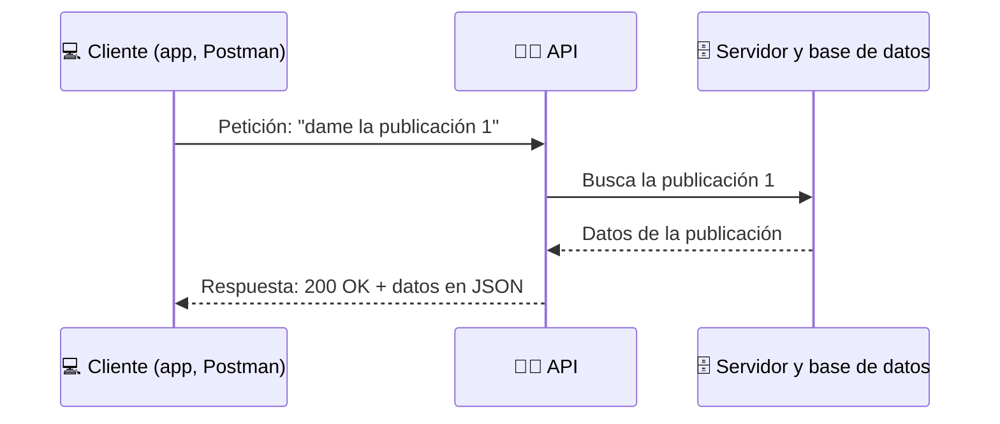

# 01 · ¿Qué es una API?

**Objetivo:** entender cómo platican dos programas antes de abrir Postman.

## La idea con un restaurante

Imagina que vas a un restaurante:

- **Tú** eres el **cliente**: quieres algo.
- **La cocina** es el **servidor**: tiene lo que quieres.
- **El mesero** es la **API**: lleva tu pedido a la cocina y te trae la respuesta.

No entras a la cocina ni sabes cómo cocinan. Solo sigues las reglas del menú.
Una **API** (*Application Programming Interface*) es exactamente eso: el menú y
las reglas para pedirle cosas a otro programa.



Cada vez que abres una app del clima, inicias sesión con Google o ves el saldo de
tu banco en el celular, una app le está haciendo peticiones a una API.

## ¿Y Postman?

**Postman** es un programa para **hacerle peticiones a una API a mano**, sin
escribir una app completa. Lo usan desarrolladores, testers y equipos de
seguridad para probar que una API responde bien.

## Las partes de una petición

| Parte | Qué es | Ejemplo |
|---|---|---|
| **Método** | Qué quieres hacer | `GET` (leer), `POST` (crear) |
| **URL** | A dónde se la mandas | `https://jsonplaceholder.typicode.com/posts/1` |
| **Headers** | Datos extra sobre la petición | `Content-Type: application/json` |
| **Body** | Los datos que envías (solo en algunos métodos) | `{ "title": "Hola" }` |

## Las partes de una respuesta

| Parte | Qué es | Ejemplo |
|---|---|---|
| **Código de estado** | Si salió bien o mal | `200 OK`, `404 Not Found` |
| **Headers** | Datos extra de la respuesta | `Content-Type: application/json` |
| **Body** | Lo que te regresa | La publicación en JSON |

## Códigos de estado que vas a ver

Se agrupan por el primer número:

| Código | Grupo | Significa |
|:-:|---|---|
| **200** OK | ✅ 2xx Éxito | Todo bien |
| **201** Created | ✅ 2xx Éxito | Se creó algo nuevo |
| **400** Bad Request | ⚠️ 4xx Error tuyo | La petición está mal hecha |
| **401** Unauthorized | ⚠️ 4xx Error tuyo | Falta iniciar sesión o un token |
| **403** Forbidden | ⚠️ 4xx Error tuyo | No tienes permiso |
| **404** Not Found | ⚠️ 4xx Error tuyo | Eso no existe |
| **500** Internal Server Error | 🔥 5xx Error del servidor | Algo falló del otro lado |

> [!TIP]
> Regla fácil: **2xx** = bien, **4xx** = tú te equivocaste, **5xx** = el servidor se equivocó.

## JSON: el idioma de las APIs

Casi todas las APIs responden en **JSON**, una forma de escribir datos que
entienden las personas y los programas:

```json
{
  "id": 1,
  "title": "Mi primera publicación",
  "publicada": true,
  "etiquetas": ["postman", "api"],
  "autor": {
    "nombre": "Ana",
    "grupo": "IRIC911-M"
  }
}
```

- Las **llaves** `{ }` agrupan datos con nombre (un *objeto*).
- Los **corchetes** `[ ]` son listas.
- Cada dato tiene un **nombre entre comillas**, dos puntos y su **valor**.
- Los valores pueden ser texto (`"Ana"`), números (`1`), `true`/`false`, listas u otros objetos.

## ✏️ Ejercicio

1. Abre en tu navegador: <https://jsonplaceholder.typicode.com/posts/1>
2. Lo que ves es la **respuesta en JSON** de una API. Identifica: ¿qué datos trae?
3. Ahora abre: <https://jsonplaceholder.typicode.com/posts/999999>
   ¿Qué pasó? ¿Qué código de estado crees que respondió?
4. Explícale a un compañero, con la comparación del restaurante, qué es una API.

## ✅ Antes de continuar

- [ ] Puedo explicar qué es una API con mis palabras
- [ ] Conozco las partes de una petición y de una respuesta
- [ ] Sé qué significan los códigos 2xx, 4xx y 5xx
- [ ] Puedo leer un JSON sencillo

---

[🏠 Inicio](../README.md) · [Siguiente: 02 · Instalación ➡️](../02-instalacion/)
