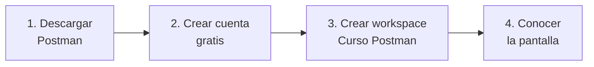

# 02 · Instalación y espacio de trabajo

**Objetivo:** dejar Postman instalado, con tu cuenta y tu espacio de trabajo del curso.

## 1. Descargar e instalar

1. Entra a <https://www.postman.com/downloads/>.
2. Descarga la versión para tu sistema (Windows, macOS o Linux).
3. Instálala con las opciones por defecto y ábrela.

> [!NOTE]
> Postman también tiene una versión web en el navegador, pero en este curso usa
> la **app de escritorio**: funciona mejor y es la que verás en las instrucciones.

## 2. Crear tu cuenta

1. Al abrir Postman, da clic en **Create Account** (o **Sign Up**).
2. Puedes registrarte con tu correo o con tu cuenta de Google.
3. Elige el plan **Free**: es todo lo que necesitas.

Sin cuenta Postman funciona en modo ligero, pero **no te deja guardar colecciones**,
y las vas a necesitar desde el módulo 05.

## 3. Crear tu espacio de trabajo (workspace)

Un **workspace** es como una carpeta grande donde vive todo tu trabajo.

1. Arriba a la izquierda, clic en **Workspaces** → **Create Workspace**.
2. Elige **Blank workspace** → **Next**.
3. Nombre: `Curso Postman`.
4. Visibilidad: **Personal** (solo tú lo ves).
5. Clic en **Create**.

## 4. Conoce la pantalla

| Zona | Dónde está | Para qué sirve |
|---|---|---|
| **Barra lateral** | Izquierda | Tus **Collections**, **Environments** e **History** |
| **Pestañas** | Arriba al centro | Cada petición abierta es una pestaña |
| **Barra de la petición** | Centro | Método + URL + botón **Send** |
| **Pestañas de la petición** | Debajo de la URL | **Params**, **Authorization**, **Headers**, **Body**, **Scripts** |
| **Respuesta** | Abajo | Código de estado, tiempo, tamaño y el **body** que regresó |
| **Selector de entorno** | Arriba a la derecha | Elegir qué entorno usar (módulo 06) |

> [!TIP]
> Los menús de Postman cambian de lugar con las actualizaciones. Si no encuentras
> algo, busca el botón **+** o el menú **⋯** (tres puntos) junto al elemento.

## 🖥️ Si usas una computadora compartida (laboratorio)

- Antes de empezar, revisa que la cuenta de Postman abierta sea **la tuya**
  (avatar arriba a la derecha). Si no, cierra sesión y entra con la tuya.
- Al terminar: avatar → **Sign Out**.

## ✏️ Ejercicio

1. Instala Postman y crea tu cuenta.
2. Crea el workspace `Curso Postman` y entra a él.
3. Ubica en tu pantalla cada zona de la tabla de arriba.

## ✅ Antes de continuar

- [ ] Postman está instalado y abre sin errores
- [ ] Inicié sesión con mi cuenta
- [ ] Estoy dentro del workspace `Curso Postman`

---

[⬅️ Anterior: 01 · ¿Qué es una API?](../01-que-es-una-api/) · [🏠 Inicio](../README.md) · [Siguiente: 03 · Tu primera petición ➡️](../03-primera-peticion/)
