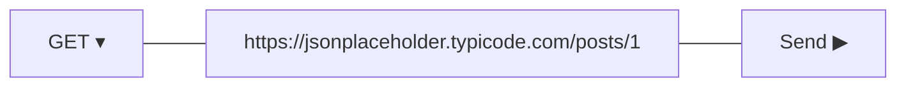

# 03 · Tu primera petición

**Objetivo:** mandar un GET y aprender a leer todo lo que regresa.

## Paso 1 · Abre una petición nueva

En tu workspace `Curso Postman`: botón **New** (o el **+** de las pestañas) → **HTTP**.

## Paso 2 · Escribe la petición

1. Deja el método en **GET**.
2. En la barra de la URL escribe:
   ```
   https://jsonplaceholder.typicode.com/posts/1
   ```
3. Clic en **Send**.



## Paso 3 · Lee la respuesta

Abajo aparece la respuesta. Fíjate en cuatro cosas:

| Dato | Dónde lo ves | Qué debe decir |
|---|---|---|
| **Código de estado** | Arriba a la derecha de la respuesta | `200 OK` en verde |
| **Tiempo** | Junto al código | Cuántos milisegundos tardó, por ejemplo `150 ms` |
| **Tamaño** | Junto al tiempo | Cuánto pesó la respuesta |
| **Body** | Pestaña **Body** → vista **Pretty** | La publicación en JSON |

```json
{
  "userId": 1,
  "id": 1,
  "title": "sunt aut facere repellat provident ...",
  "body": "quia et suscipit ..."
}
```

> [!NOTE]
> El texto viene en latín de relleno (*lorem ipsum*). Es normal: es una API de práctica.

Revisa también la pestaña **Headers** de la respuesta: ahí verás, por ejemplo,
`Content-Type: application/json`, que avisa que el body viene en JSON.

## Paso 4 · Prueba otras direcciones

| URL | Qué regresa |
|---|---|
| `https://jsonplaceholder.typicode.com/posts` | Lista de 100 publicaciones |
| `https://jsonplaceholder.typicode.com/users` | Lista de 10 usuarios |
| `https://jsonplaceholder.typicode.com/users/1` | Un solo usuario |
| `https://jsonplaceholder.typicode.com/posts/1/comments` | Comentarios de la publicación 1 |

> [!TIP]
> Fíjate en el patrón: `/posts` es **la lista** y `/posts/1` es **uno solo**.
> Casi todas las APIs siguen esa misma idea.

## Paso 5 · Provoca un error a propósito

Manda un GET a:

```
https://jsonplaceholder.typicode.com/posts/999999
```

Responde **`404 Not Found`** y un body vacío `{}`: esa publicación no existe.
Los errores también son respuestas, y saber leerlos es la mitad del trabajo.

## ✏️ Ejercicio

1. Haz un GET a `/users` y contesta: ¿cuántos usuarios hay? ¿Cómo se llama el usuario 3?
2. Haz un GET a `/users/1` y busca en el JSON en qué ciudad vive (`address` → `city`).
3. Haz un GET a `/posts/999999` y anota el código de estado.
4. Abre **History** en la barra lateral: ahí están todas las peticiones que hiciste.

## ✅ Antes de continuar

- [ ] Sé hacer un GET y leer el código de estado, el tiempo y el body
- [ ] Entiendo la diferencia entre `/posts` y `/posts/1`
- [ ] Ya vi un `404` y sé qué significa

---

[⬅️ Anterior: 02 · Instalación](../02-instalacion/) · [🏠 Inicio](../README.md) · [Siguiente: 04 · Métodos y datos ➡️](../04-metodos-y-datos/)
