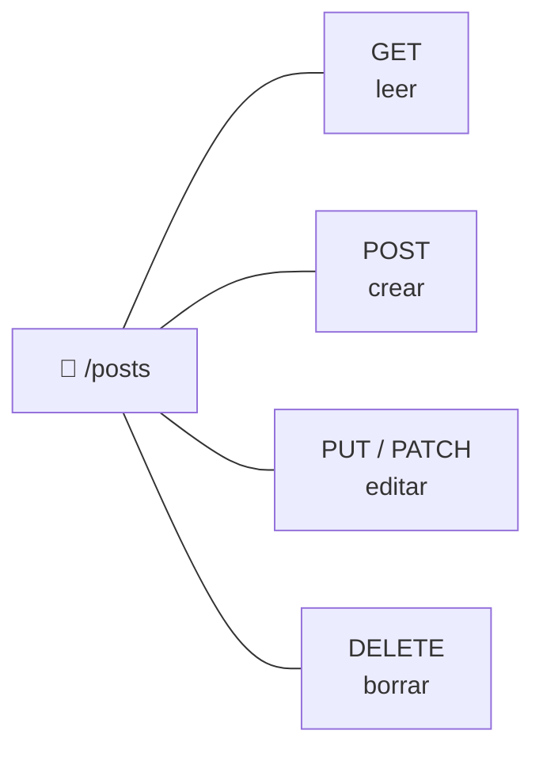

# 04 · Métodos y datos

**Objetivo:** crear, editar y borrar datos, y mandar información en la petición.

## Los métodos HTTP

Con una sola dirección (`/posts`) puedes hacer cosas distintas cambiando el **método**:

| Método | Para qué | Ejemplo | Lleva body | Responde |
|:-:|---|---|:-:|:-:|
| **GET** | Leer | `GET /posts/1` | No | `200` |
| **POST** | Crear | `POST /posts` | Sí | `201` |
| **PUT** | Reemplazar completo | `PUT /posts/1` | Sí | `200` |
| **PATCH** | Cambiar solo una parte | `PATCH /posts/1` | Sí | `200` |
| **DELETE** | Borrar | `DELETE /posts/1` | No | `200` |



> [!NOTE]
> A estas cuatro acciones se les llama **CRUD**: *Create, Read, Update, Delete*.

## 1. Parámetros de búsqueda (Params)

Sirven para **filtrar** lo que pides. Van después de un `?` en la URL.

1. Nueva petición **GET** a `https://jsonplaceholder.typicode.com/posts`.
2. Abre la pestaña **Params** y agrega:

   | Key | Value |
   |---|---|
   | `userId` | `1` |

3. Fíjate cómo la URL cambia sola a `.../posts?userId=1`.
4. **Send**: ahora solo salen las publicaciones del usuario 1.

## 2. Crear con POST y un body en JSON

1. Nueva petición, método **POST**, URL `https://jsonplaceholder.typicode.com/posts`.
2. Pestaña **Body** → elige **raw** → en el menú de la derecha elige **JSON**.
3. Escribe:

   ```json
   {
     "title": "Mi primera publicación",
     "body": "Aprendiendo Postman en la UTN",
     "userId": 1
   }
   ```

4. **Send**. Debe responder **`201 Created`** y regresar tu publicación con un `"id": 101`.

> [!IMPORTANT]
> Al elegir **JSON**, Postman agrega solo el header `Content-Type: application/json`.
> Sin ese header, muchas APIs no entienden lo que les mandas.

## 3. Editar con PUT y PATCH

**PUT** reemplaza toda la publicación:

1. Método **PUT**, URL `https://jsonplaceholder.typicode.com/posts/1`.
2. **Body** → **raw** → **JSON**:

   ```json
   {
     "id": 1,
     "title": "Título corregido",
     "body": "Texto nuevo completo",
     "userId": 1
   }
   ```

3. **Send** → `200 OK`.

**PATCH** cambia solo lo que mandas:

1. Método **PATCH**, misma URL.
2. Body:

   ```json
   {
     "title": "Solo cambio el título"
   }
   ```

3. **Send** → `200 OK`. Fíjate que el resto de los datos sigue igual.

## 4. Borrar con DELETE

1. Método **DELETE**, URL `https://jsonplaceholder.typicode.com/posts/1`.
2. Sin body. **Send** → `200 OK` y un body vacío `{}`.

## 5. Headers

Los **headers** son datos extra de la petición. Revisa la pestaña **Headers**:
Postman agrega varios solos (ocultos; da clic en *hidden* para verlos). Los más
comunes que vas a escribir tú:

| Header | Para qué |
|---|---|
| `Content-Type: application/json` | Aviso que el body va en JSON |
| `Accept: application/json` | Pido que la respuesta venga en JSON |
| `Authorization: Bearer TOKEN` | Me identifico con un token (APIs con login) |

> [!WARNING]
> Un **token** es como una contraseña. Nunca lo pegues en un chat ni lo subas a GitHub.
> En el módulo 06 verás cómo guardarlo de forma segura.

## ✏️ Ejercicio

Haz y prueba estas peticiones (todavía no tienes que guardarlas; eso es en el
módulo 05):

1. **GET** a `/comments` con el parámetro `postId` = `1`.
2. **POST** a `/posts` con tu nombre como `title`.
3. **PUT** a `/posts/1` con el body completo.
4. **PATCH** a `/posts/1` cambiando solo el `body`.
5. **DELETE** a `/posts/1`.

Anota qué código de estado respondió cada una.

## 🔎 Evidencia para el reto final

> [!IMPORTANT]
> En tu colección final (módulo 05) debe haber peticiones con los métodos
> **GET, POST, PUT y DELETE**, y el **POST** y el **PUT** deben llevar un **body en JSON**.

> [!TIP]
> **¿Ya quedó bien?** Haz `git push` y comenta `/revisar` en tu Issue de avance.
> Si todavía no lo tienes, ábrelo aquí: [📈 Revisar mi avance](https://github.com/git-master-utn/aprende-postman/issues/new?template=revisar-avance.md&title=Revisar+mi+avance).

## ✅ Antes de continuar

- [ ] Sé para qué sirve cada método
- [ ] Sé filtrar con Params
- [ ] Mandé un POST con body en JSON y me respondió `201`
- [ ] Sé la diferencia entre PUT y PATCH

---

[⬅️ Anterior: 03 · Tu primera petición](../03-primera-peticion/) · [🏠 Inicio](../README.md) · [Siguiente: 05 · Colecciones ➡️](../05-colecciones/)
