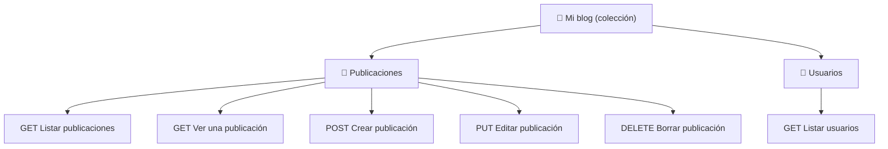

# 05 · Colecciones

**Objetivo:** guardar tus peticiones en orden para no volver a escribirlas.

## ¿Qué es una colección?

Una **colección** es una carpeta de peticiones guardadas. Dentro puedes hacer
**subcarpetas** para ordenarlas por tema. Es lo que vas a entregar en el reto final.

## 1. Crea la colección

1. En la barra lateral, clic en **Collections**.
2. Botón **+** (o **Create Collection**) → **Blank collection**.
3. Nombre: `Mi blog`.

## 2. Crea las carpetas

1. Pasa el mouse sobre `Mi blog` → **⋯** → **Add folder**.
2. Nombre: `Publicaciones`.
3. Repite para crear la carpeta `Usuarios`.

## 3. Guarda tus peticiones

Para cada petición:

1. Ábrela (o créala) con su método, URL y body.
2. Presiona **Ctrl + S** (o el botón **Save**).
3. Escribe un **nombre claro**, por ejemplo `Crear publicación`.
4. Elige la carpeta donde va (por ejemplo `Mi blog / Publicaciones`) → **Save**.

Otra forma: **⋯** sobre una carpeta → **Add request**: se crea ya guardada ahí.

> [!TIP]
> Ponle a cada petición un nombre que diga **qué hace**, no solo la URL.
> `Crear publicación` se entiende mejor que `POST posts`.

## 4. Las peticiones de tu colección

Arma esta colección; es la que vas a usar hasta el final del curso:

| Carpeta | Nombre | Método | URL |
|---|---|:-:|---|
| Publicaciones | Listar publicaciones | GET | `https://jsonplaceholder.typicode.com/posts` |
| Publicaciones | Ver una publicación | GET | `https://jsonplaceholder.typicode.com/posts/1` |
| Publicaciones | Crear publicación | POST | `https://jsonplaceholder.typicode.com/posts` |
| Publicaciones | Editar publicación | PUT | `https://jsonplaceholder.typicode.com/posts/1` |
| Publicaciones | Borrar publicación | DELETE | `https://jsonplaceholder.typicode.com/posts/1` |
| Usuarios | Listar usuarios | GET | `https://jsonplaceholder.typicode.com/users` |

Usa en **Crear publicación** y **Editar publicación** los body en JSON del módulo 04.

> [!NOTE]
> En el módulo 06 vas a cambiar todas esas URL largas por `{{base_url}}`.
> Por ahora déjalas así.

## 5. Documenta tu colección

Da clic en el nombre `Mi blog` y escribe una descripción corta en la pestaña
**Overview**, por ejemplo: *"Colección de práctica del curso aprende-postman"*.
Puedes hacer lo mismo en cada petición.

## ✏️ Ejercicio

1. Crea la colección `Mi blog` con las carpetas `Publicaciones` y `Usuarios`.
2. Guarda las 6 peticiones de la tabla, cada una en su carpeta.
3. Agrega una petición más que tú elijas (por ejemplo, `GET /todos?userId=1`) en una carpeta nueva.
4. Cierra todas las pestañas y abre las peticiones desde la colección: deben estar tal como las guardaste.

## 🔎 Evidencia para el reto final

> [!IMPORTANT]
> Tu colección debe tener **al menos 5 peticiones** y estar **organizada en carpetas**.

## ✅ Antes de continuar

- [ ] Tengo la colección `Mi blog` con carpetas
- [ ] Guardé al menos 6 peticiones con nombres claros
- [ ] Sé guardar una petición nueva dentro de una carpeta

---

[⬅️ Anterior: 04 · Métodos y datos](../04-metodos-y-datos/) · [🏠 Inicio](../README.md) · [Siguiente: 06 · Variables y entornos ➡️](../06-variables-y-entornos/)
