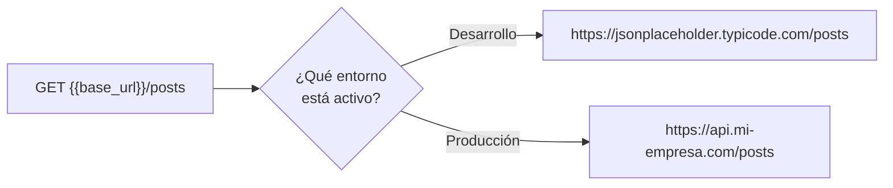

# 06 · Variables y entornos

**Objetivo:** dejar de repetir la misma dirección en cada petición y poder
cambiar de servidor con un clic.

## El problema

Ahora mismo, tus 6 peticiones repiten `https://jsonplaceholder.typicode.com`.
Si mañana la API cambia de dirección, tendrías que editar las 6 a mano.

## La solución: variables

Una **variable** es un nombre que guarda un valor. En Postman se escribe entre
**dobles llaves**:

```
{{base_url}}/posts/1
```

Postman reemplaza `{{base_url}}` por su valor justo antes de mandar la petición.

## ¿Dónde viven las variables?

| Tipo | Se usa en | Ejemplo |
|---|---|---|
| **Global** | Todo el workspace | Casi no se recomienda |
| **De colección** | Solo esa colección | Valores que nunca cambian |
| **De entorno** | Mientras ese entorno esté seleccionado | `base_url`, usuarios y tokens de prueba |

Un **entorno** (*environment*) es un grupo de variables para un lugar específico.
Por ejemplo, el mismo `base_url` puede apuntar a tu servidor de pruebas o al real:



## 1. Crea el entorno "Desarrollo"

1. Barra lateral → **Environments** → **+**.
2. Nombre: `Desarrollo`.
3. Agrega la variable:

   | Variable | Value |
   |---|---|
   | `base_url` | `https://jsonplaceholder.typicode.com` |

4. **Save** (Ctrl + S).
5. Arriba a la derecha, en el selector de entornos (donde dice *No environment*),
   elige **Desarrollo**.

## 2. Usa la variable en tus peticiones

Abre cada petición de `Mi blog` y cambia la parte inicial de la URL:

| Antes | Después |
|---|---|
| `https://jsonplaceholder.typicode.com/posts` | `{{base_url}}/posts` |
| `https://jsonplaceholder.typicode.com/posts/1` | `{{base_url}}/posts/1` |
| `https://jsonplaceholder.typicode.com/users` | `{{base_url}}/users` |

Guarda cada una (Ctrl + S) y dale **Send**: debe funcionar igual que antes.

> [!TIP]
> Si `{{base_url}}` sale en **rojo**, Postman no la encuentra: revisa que el
> entorno **Desarrollo** esté seleccionado arriba a la derecha y que la variable
> esté escrita igual (sin espacios, minúsculas).

Pasa el mouse sobre `{{base_url}}` en la URL: Postman te muestra su valor y de
qué entorno viene.

## 3. Guarda valores de las respuestas en variables

Puedes guardar algo que te regresó la API para usarlo después. En **Crear
publicación**, pestaña **Scripts** → **Post-response**:

```javascript
const datos = pm.response.json();
pm.environment.set("post_id", datos.id);
```

Manda la petición y revisa tu entorno: ahora existe `post_id` con el valor `101`.
Ya puedes usarla en otra URL, por ejemplo `{{base_url}}/posts/{{post_id}}`.

> [!NOTE]
> Con JSONPlaceholder, `GET /posts/101` responde `404` porque la publicación no se
> guardó de verdad. Lo importante es que aprendas a pasar datos de una petición a otra.

## 4. Datos secretos (tokens y contraseñas)

> [!WARNING]
> Si una API te da un **token**, guárdalo en una variable de entorno de tipo
> **secret** y **déjalo vacío antes de exportar**. En el módulo 08 vas a subir tu
> entorno a GitHub y lo podrá ver cualquiera.

## ✏️ Ejercicio

1. Crea el entorno `Desarrollo` con la variable `base_url`.
2. Cambia **todas** las URL de tu colección para que empiecen con `{{base_url}}`.
3. Agrega el script que guarda `post_id` en **Crear publicación** y comprueba que la variable aparece.
4. (Opcional) Crea un segundo entorno `Producción` con otro `base_url` y fíjate cómo cambia la URL al seleccionarlo.

## 🔎 Evidencia para el reto final

> [!IMPORTANT]
> Las URL de tu colección deben usar `{{base_url}}`, y vas a subir tu entorno
> **Desarrollo** con la variable `base_url` (módulo 08).

> [!TIP]
> **¿Ya quedó bien?** Haz `git push` y comenta `/revisar` en tu Issue de avance.
> Si todavía no lo tienes, ábrelo aquí: [📈 Revisar mi avance](https://github.com/git-master-utn/aprende-postman/issues/new?template=revisar-avance.md&title=Revisar+mi+avance).

## ✅ Antes de continuar

- [ ] Tengo el entorno `Desarrollo` seleccionado
- [ ] Todas mis peticiones usan `{{base_url}}`
- [ ] Sé guardar un dato de la respuesta en una variable

---

[⬅️ Anterior: 05 · Colecciones](../05-colecciones/) · [🏠 Inicio](../README.md) · [Siguiente: 07 · Pruebas ➡️](../07-pruebas/)
