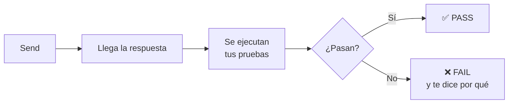

# 07 · Pruebas automáticas

**Objetivo:** que Postman revise solo si la respuesta es correcta, en vez de leerla tú cada vez.

## ¿Por qué probar?

Imagina que tu colección tiene 50 peticiones. Revisar a ojo cada respuesta es
lento y se te escapan errores. Con **pruebas**, Postman te dice en verde o rojo
si cada respuesta cumple lo que esperas.



## ¿Dónde se escriben?

En cada petición: pestaña **Scripts** → **Post-response**. Se ejecutan **después**
de recibir la respuesta. Los resultados salen abajo, en la pestaña **Test Results**.

> [!TIP]
> A la derecha del editor hay **Snippets**: ejemplos listos que se insertan con un clic.

## Tu primera prueba

En **Listar publicaciones**, escribe en **Post-response**:

```javascript
pm.test("Responde 200 OK", function () {
    pm.response.to.have.status(200);
});
```

Manda la petición y abre **Test Results**: debe decir **PASS**.

Así se lee:
- `pm.test("nombre", function () { ... })` crea una prueba con un nombre.
- Adentro va lo que esperas que sea cierto. Si no se cumple, la prueba falla.

## Pruebas más comunes

**Código de estado:**

```javascript
pm.test("Responde 201 Created", function () {
    pm.response.to.have.status(201);
});
```

**Que responda rápido:**

```javascript
pm.test("Responde en menos de 1 segundo", function () {
    pm.expect(pm.response.responseTime).to.be.below(1000);
});
```

**Que venga en JSON:**

```javascript
pm.test("La respuesta viene en JSON", function () {
    pm.response.to.have.header("Content-Type");
    pm.expect(pm.response.headers.get("Content-Type")).to.include("application/json");
});
```

**Que la lista no venga vacía:**

```javascript
pm.test("Regresa una lista con publicaciones", function () {
    const datos = pm.response.json();
    pm.expect(datos).to.be.an("array").that.is.not.empty;
});
```

**Que un dato tenga el valor esperado:**

```javascript
pm.test("Regresa el título que mandé", function () {
    const datos = pm.response.json();
    pm.expect(datos.title).to.eql("Mi primera publicación");
});
```

**Que exista un campo:**

```javascript
pm.test("La publicación tiene id", function () {
    pm.expect(pm.response.json()).to.have.property("id");
});
```

## Haz fallar una prueba a propósito

En **Ver una publicación**, cambia temporalmente la URL a `{{base_url}}/posts/999999`
y manda la petición con la prueba de `200`. Verás **FAIL** con el motivo:
*expected response to have status code 200 but got 404*. Regresa la URL a como estaba.

## ✏️ Ejercicio

Agrega **al menos 2 pruebas** en cada una de estas peticiones:

| Petición | Pruebas sugeridas |
|---|---|
| Listar publicaciones | Status `200` + lista no vacía |
| Ver una publicación | Status `200` + tiene `id` |
| Crear publicación | Status `201` + regresa el título que mandaste |
| Editar publicación | Status `200` + regresa el título nuevo |
| Borrar publicación | Status `200` + responde en menos de 1 segundo |

Guarda cada petición (Ctrl + S) después de agregar sus pruebas.

## 🔎 Evidencia para el reto final

> [!IMPORTANT]
> Al menos **3 peticiones** de tu colección deben tener pruebas con `pm.test`.
> Recuerda **guardar**: si no guardas, las pruebas no se exportan.

> [!TIP]
> **¿Ya quedó bien?** Haz `git push` y comenta `/revisar` en tu Issue de avance.
> Si todavía no lo tienes, ábrelo aquí: [📈 Revisar mi avance](https://github.com/git-master-utn/aprende-postman/issues/new?template=revisar-avance.md&title=Revisar+mi+avance).

## ✅ Antes de continuar

- [ ] Sé dónde se escriben las pruebas y dónde veo sus resultados
- [ ] Tengo pruebas en al menos 3 peticiones y todas pasan
- [ ] Ya vi una prueba fallar y entendí el mensaje

---

[⬅️ Anterior: 06 · Variables y entornos](../06-variables-y-entornos/) · [🏠 Inicio](../README.md) · [Siguiente: 08 · Runner y exportar ➡️](../08-runner-y-exportar/)
