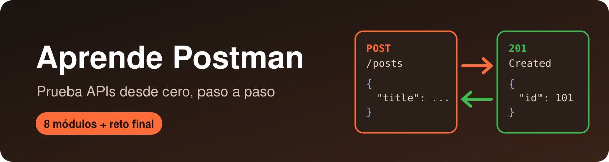
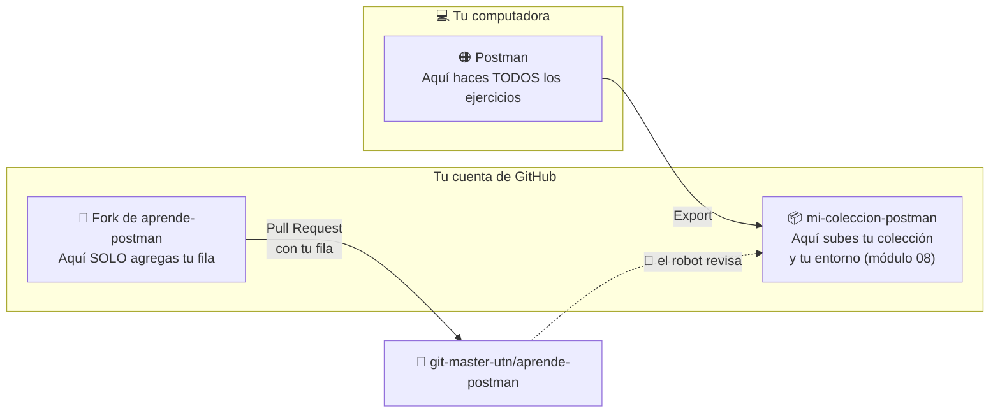
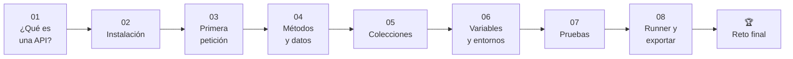
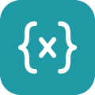

<p align="center">
  
</p>

<p align="center">
  
  
  
  
</p>

# 👋 Bienvenido

Este repositorio es un **curso práctico para aprender a probar APIs con Postman
desde cero**. No necesitas saber programar: solo una computadora, internet y ganas.

Vas a construir, paso a paso, una colección de Postman que habla con una API real
de práctica. Al final la subes a GitHub y un robot revisa que hayas hecho todo.

> [!NOTE]
> **Antes de empezar** te conviene haber terminado el curso
> [aprende-github](https://github.com/git-master-utn/aprende-github): en el
> módulo 08 vas a subir tu colección a un repositorio.

## 🤖 Antes de empezar: un robot revisa tu trabajo

Este curso **no se aprueba solo con el último paso**. Cuando mandas tu Pull Request
del [reto final](reto-final/), un robot abre tu colección de Postman y comprueba
que hiciste los ejercicios de **cada módulo**. Te deja un comentario con tu
calificación sobre 10, lo que cumpliste ✅ y lo que te falta ❌.



> [!IMPORTANT]
> **Las 3 reglas para que el robot te apruebe:**
> 1. Crea en **tu** cuenta de GitHub un repo **público** llamado **exactamente** `mi-coleccion-postman`.
> 2. Sube ahí **tu colección y tu entorno exportados** desde Postman (módulo 08).
> 3. Al final de cada módulo hay una caja **"🔎 Evidencia para el reto final"**: cúmplela antes de seguir.

> [!TIP]
> ¿El robot te marcó algo en rojo? **No es que esté descompuesto:** te está diciendo
> exactamente qué te falta. Lee la tabla
> [Si el robot marca algo en rojo](reto-final/#si-el-robot-marca-algo-en-rojo),
> arréglalo y pide otra revisión.

## 🗺️ Ruta de aprendizaje



|  | Módulo | Qué vas a aprender | Tiempo |
|:-:|---|---|:-:|
|  | [**01 · ¿Qué es una API?**](01-que-es-una-api/) | Cliente, servidor, petición, respuesta, códigos de estado y JSON | 20 min |
|  | [**02 · Instalación**](02-instalacion/) | Instalar Postman, crear tu cuenta y tu espacio de trabajo | 20 min |
|  | [**03 · Tu primera petición**](03-primera-peticion/) | Hacer un GET y leer la respuesta | 20 min |
|  | [**04 · Métodos y datos**](04-metodos-y-datos/) | GET, POST, PUT, PATCH, DELETE, parámetros, headers y body | 40 min |
|  | [**05 · Colecciones**](05-colecciones/) | Guardar y organizar tus peticiones en carpetas | 20 min |
|  | [**06 · Variables y entornos**](06-variables-y-entornos/) | Usar `{{base_url}}` y cambiar de entorno con un clic | 30 min |
|  | [**07 · Pruebas**](07-pruebas/) | Validar respuestas automáticamente con `pm.test()` | 40 min |
|  | [**08 · Runner y exportar**](08-runner-y-exportar/) | Correr toda la colección y subirla a GitHub | 30 min |
| 🏆 | [**Reto final**](reto-final/) | El robot revisa tu colección y te agrega a la lista | 15 min |

## 🧪 La API con la que vas a practicar

Todo el curso usa **[JSONPlaceholder](https://jsonplaceholder.typicode.com)**, una
API pública y gratuita hecha para practicar. No necesitas registrarte.

```
https://jsonplaceholder.typicode.com
```

Tiene publicaciones (`/posts`), comentarios (`/comments`), usuarios (`/users`) y
tareas (`/todos`).

> [!NOTE]
> JSONPlaceholder **simula** los cambios: si creas una publicación, responde como
> si la hubiera guardado, pero no la guarda de verdad. Es perfecto para practicar
> sin romper nada.

## 🚀 ¿Cómo usar este repo?

1. Sigue los módulos **en orden**; cada uno usa lo del anterior.
2. **Haz tú mismo cada petición** en Postman. Ver capturas no es lo mismo que practicar.
3. Haz el **ejercicio** al final de cada módulo antes de pasar al siguiente.
4. Ten a la mano el [**cheatsheet**](cheatsheet.md) con métodos, códigos y pruebas.
5. Termina con el [**reto final**](reto-final/): el robot revisa que hayas hecho todo.

## 📎 Material de apoyo

- Dirección de este repositorio: <https://github.com/git-master-utn/aprende-postman>
- [Cheatsheet](cheatsheet.md)
- [Lista de alumnos que completaron el curso](reto-final/alumnos.md)
- Curso anterior: [aprende-github](https://github.com/git-master-utn/aprende-github)

## 🙌 Créditos

Elaborado por **Luis Ángel Pérez González** como parte de su servicio social en la
División Académica de Telemática de la **Universidad Tecnológica de Nezahualcóyotl**.

Puedes usar y adaptar este material libremente para dar clases.
