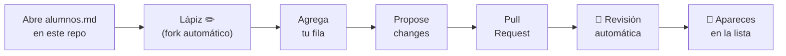

# 🏆 Reto final

**Objetivo:** demostrar que completaste **todo el curso**. Un robot abre tu
colección de Postman y revisa la evidencia de cada módulo.

> [!IMPORTANT]
> Haz este reto **al final**, cuando ya tengas tu colección y tu entorno subidos
> a tu repo `mi-coleccion-postman` (módulo 08). Si te saltaste algo, el robot te
> lo va a decir.

## ✅ Requisitos antes de empezar

Todo se revisa en **tu** repositorio `mi-coleccion-postman`. Debe ser **público**,
llamarse **exactamente** así y tener tu colección y tu entorno exportados.

| Módulo | Evidencia que se revisa | Puntos |
|:-:|---|:-:|
| [08](../08-runner-y-exportar/) | Hay una colección exportada en formato **v2.1** | 1 |
| [05](../05-colecciones/) | La colección tiene **al menos 5 peticiones** | 1 |
| [05](../05-colecciones/) | Las peticiones están **organizadas en carpetas** | 1 |
| [04](../04-metodos-y-datos/) | Usa los métodos **GET, POST, PUT y DELETE** | 2 |
| [04](../04-metodos-y-datos/) | El **POST** y el **PUT** llevan **body en JSON** | 1 |
| [06](../06-variables-y-entornos/) | **Todas** las URL usan `{{base_url}}` | 1 |
| [06](../06-variables-y-entornos/) | Subiste el **archivo del entorno** con la variable `base_url` | 1 |
| [07](../07-pruebas/) | Hay pruebas `pm.test` en **al menos 3 peticiones** | 2 |
| | **Total** | **10** |

Lo más difícil (métodos y pruebas) vale más. Los módulos 01 a 03 son la base de
todo lo demás y el 01 se evalúa en clase.

## Pasos



**1.** Inicia sesión en GitHub con **tu** cuenta (revisa el avatar).

**2.** Abre [`reto-final/alumnos.md`](alumnos.md) en
[git-master-utn/aprende-postman](https://github.com/git-master-utn/aprende-postman)
y da clic en el **lápiz** ✏️. GitHub te ofrece hacer un fork: acéptalo
(**Fork this repository**).

**3.** Agrega **una fila al final de la tabla** con tus datos, siguiendo el ejemplo.
El usuario debe ser **el tuyo**:

```
| Tu Nombre | [@TU-USUARIO](https://github.com/TU-USUARIO) | IRIC911-M | 2026-11-26 |
```

**4.** **Commit changes** → **Propose changes** → **Create pull request**.
En el título escribe `Reto final: Tu Nombre` y llena la lista de la descripción
→ **Create pull request**.

> [!TIP]
> También lo puedes hacer con Git Bash como en el reto de `aprende-github`
> (fork, clone, rama, commit, push y Pull Request).

## 🤖 ¿Qué pasa después?

En un minuto aparece un **comentario automático** en tu Pull Request con tu
**calificación sobre 10** y una tabla: ✅ lo que ya cumpliste y ❌ lo que te falta.

- Si todo sale en ✅ (10 / 10), el robot **te agrega solo a la [lista de alumnos](alumnos.md)**
  y cierra tu Pull Request con un mensaje de felicitación. Que se cierre es normal:
  tu fila ya quedó en la lista.
- Si algo sale en ❌, ve al módulo indicado, corrígelo en Postman, **vuelve a
  exportar** y sube los archivos a tu `mi-coleccion-postman` con `git push`.
  Después **edita la descripción de tu Pull Request** (agrega un espacio y guarda)
  para que el robot vuelva a revisar. **No abras otro PR.**

## Si el robot marca algo en rojo

| El robot dice... | Por qué pasa | Cómo se arregla |
|---|---|---|
| Repo `TU-USUARIO/mi-coleccion-postman`: **No existe, es privado o tiene otro nombre** | No creaste el repo, le pusiste otro nombre, es privado o lo hiciste con otra cuenta | Revisa `github.com/TU-USUARIO?tab=repositories`. Renómbralo en **Settings → Repository name** o cámbialo a **Public** en **Settings → Change visibility**. Si no existe, haz el [módulo 08](../08-runner-y-exportar/) |
| **No encontré una colección exportada en formato v2.1** | No subiste el `.json` de la colección, lo exportaste en v2.0 o lo subiste dentro de una carpeta comprimida | Exporta otra vez con **Collection v2.1** y sube el `.json` tal cual (no `.zip`) |
| **Al menos 5 peticiones** | Te faltan peticiones o no las **guardaste** antes de exportar | Guarda cada petición (Ctrl + S) en la colección y vuelve a exportar |
| **Organizadas en carpetas** | Todas tus peticiones están sueltas en la colección | Crea carpetas y arrastra tus peticiones adentro ([módulo 05](../05-colecciones/)) |
| **GET, POST, PUT y DELETE** | Te falta alguno de los cuatro métodos | Agrega la petición que falte ([módulo 04](../04-metodos-y-datos/)) |
| **Body en JSON** | Tu POST o tu PUT no tienen body, o no elegiste **raw → JSON** | Pestaña **Body** → **raw** → **JSON** y escribe el JSON |
| **Todas las URL usan `{{base_url}}`** | Alguna petición todavía tiene la dirección completa | Cambia el inicio de cada URL por `{{base_url}}` ([módulo 06](../06-variables-y-entornos/)) |
| **Archivo del entorno con `base_url`** | No exportaste el entorno o la variable se llama distinto | Exporta el entorno **Desarrollo** y revisa que la variable se llame exactamente `base_url` |
| **Pruebas en al menos 3 peticiones** | Tienes menos de 3 peticiones con `pm.test`, o no guardaste | Agrega pruebas en **Scripts → Post-response**, guarda y vuelve a exportar ([módulo 07](../07-pruebas/)) |
| **Solo debes modificar `reto-final/alumnos.md`** | Cambiaste otros archivos del curso | Cierra tu PR, borra tu fork y vuelve a hacer el reto agregando **solo** tu fila |
| **Debes agregar exactamente una fila** | Agregaste más de una fila o la de otra persona | Cada quien manda su propio PR con **una sola** fila |
| **No borres ni cambies las filas de tus compañeros** | Modificaste filas que ya estaban | Deja la tabla como estaba y agrega tu fila **al final** |
| **El usuario de tu fila debe ser el tuyo** | Escribiste mal tu usuario | Corrige el usuario: debe ser el de la cuenta que mandó el PR |
| **Tu fila debe tener las 4 columnas llenas** | Falta un dato | Llena Nombre, Usuario, Grupo y Fecha |

> [!TIP]
> Después de corregir en Postman **siempre vuelve a exportar** y haz `git push`.
> El robot revisa lo que está en GitHub, no lo que tienes en tu computadora.

> [!NOTE]
> Si ya revisaste todo y estás seguro de que el robot se equivoca, abre un
> [Issue](https://github.com/git-master-utn/aprende-postman/issues/new) con el
> enlace a tu Pull Request y una captura. Si la tabla del robot se ve
> desacomodada, desactiva la traducción del navegador.

## Reglas

- Solo modifica `reto-final/alumnos.md`.
- Agrega **una sola fila** y no borres las de tus compañeros.
- Usa tu propio usuario en la fila.

---

[⬅️ Anterior: 08 · Runner y exportar](../08-runner-y-exportar/) · [🏠 Inicio](../README.md)
